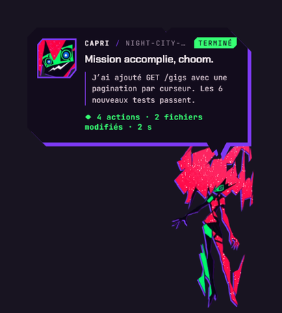

## **Project Capricorn (2.00.06)**

Capri, the construct **Project Capricorn** from *Cyberpunk: Edgerunners* (Season 2), lives on your desktop. She watches your coding assistant — **Claude Code**, **Codex**, or **Antigravity** — teleports around, causes glitches, comments on every action, rushes over when permission is needed, and bursts with joy when the work is finished.

She can also **chat with you** through any AI — **Claude**, Ollama on your computer, Gemini, GPT, Groq, and others — get angry, laugh, sulk, speak, change color, see your screen, listen to you, dance to your music, remember who you are, and live her own life while you work.

> Fan-made project. Responses are generated by AI, not by the show's writers.




## Main features

- **Coding AI monitoring** (Claude Code, Codex, Antigravity): Capri comments on actions, asks for your permission when needed, and reacts when the task is finished.
- **AI conversation**: local Ollama, Claude, Gemini, GPT, Groq, and other providers. Capri can speak using Piper, Chatterbox, the system voice, or a cloud service.
- **Desktop life**: she sits on windows or the taskbar, swings her legs, floats, falls, sleeps, teleports, looks at the satellite, and reacts to the cursor.
- **Window possession**: she can move your windows in eight different ways, then put them back where they were. She immediately releases a window that you grab yourself.
- **Automatic setup**: she analyzes the CPU, memory, graphics card, and disk, then recommends and installs Ollama, a model, Piper, Chatterbox, or Node.js as needed.
- **Model tuning**: settings are adapted for conversation, notes, and screen analysis according to model size, language, and measured performance on your computer.
- **Custom voice**: Chatterbox can use a voice sample lasting 5 to 30 seconds.
- **Cleanup**: the menu shows how much space downloaded components occupy and lets you remove items that belong to Capri.

## Table of contents

1. [Quick start](#quick-start)
2. [Installation and launch](#installation-and-launch)
3. [Connecting to an AI](#connecting-to-an-ai)
4. [Monitoring Claude Code, Codex, and Antigravity](#monitoring-claude-code-codex-and-antigravity)
5. [Using Capri](#using-capri)
6. [Configuration](#configuration)
7. [Detailed features](#detailed-features)
8. [Demo without Claude](#demo-without-claude)
9. [Security](#security)
10. [Data sent off your computer](#data-sent-off-your-computer)
11. [Troubleshooting](#troubleshooting)
12. [Frequently asked questions](#frequently-asked-questions)
13. [Rendering and animation](#rendering-and-animation)
14. [Developers](#developers)
15. [Authors and rights](#authors-and-rights)
16. [Project structure and security review](#project-structure-and-security-review)

---

## Quick start

1. Download and install Capri from the project's releases page.
2. On first launch, choose an AI from the **AI** menu.
3. To monitor your coding assistant, install the hooks offered in the menu.
4. To talk to Capri, open the circular menu and choose **Talk to me**.

Capri automatically detects French, English, or Russian based on the system language. You can change the language at any time under **More › Language** or in the system tray menu.

## Installation and launch

### Option 1: Windows installer

Download the `.exe` installer, run it, and follow the steps. Capri can start automatically with Windows. The installer also creates a shortcut in the Start menu and, if you choose, on the desktop.

Windows may display a SmartScreen warning because the installer is unsigned. This does not mean Capri performs hidden operations: the application's code is available in this repository.

### Option 2: From source

Requirements:

- Node.js 20 or later;
- npm;
- Windows, macOS, or Linux.

```bash
git clone https://github.com/mochiiwuff/capri-desktop.git
cd capri-desktop
npm install
npm start
```

For development mode:

```bash
npm run dev
```

To build the Windows installer:

```bash
npm run dist
```

### Installation issues

| Symptom | Solution |
|---|---|
| `node` or `npm` cannot be found | Install Node.js from [nodejs.org](https://nodejs.org), add it to your `PATH`, then open a new terminal. |
| `npm install` gets stuck on Electron | Check your connection, VPN, and antivirus, then run `npm install` again. |
| Capri does not start | Run `npm run dev` from a terminal and check the error message. |
| Capri's background is black | Choose **Display › OpenGL**, then **Display › No graphics card** if necessary. |

## Connecting to an AI

Capri can work with a local AI, a cloud provider, or Claude Code.

### Claude with an API key

1. Create a key in [Anthropic Console](https://console.anthropic.com/settings/keys).
2. In Capri, open **AI › Claude · API key**.
3. Paste the key and select **Connect**.
4. Choose the model from the same menu.

The key can also come from `ANTHROPIC_API_KEY` or an `ant auth login` session. It is stored encrypted by the operating system and is sent only to Anthropic's servers.

### Claude Code with a subscription

Install Claude Code and sign in:

```bash
npm install -g @anthropic-ai/claude-code
claude
```

In Capri, choose **AI › Claude Code · subscription**. Select the working directory and permission level under **AI › AI model**. The `default` mode is used by default; `acceptEdits` allows changes without an intermediate prompt.

### Ollama on your computer

Ollama does not require a key and keeps data on your PC.

1. Open **AI › Connection assistant › On my PC**.
2. Capri installs Ollama if necessary and suggests a model.
3. By default, it uses `127.0.0.1:11434`, or the value of `OLLAMA_HOST`.

Common models:

- `gemma3:4b` or later: better multilingual results;
- `llama3.2`: lighter for low-spec systems.

You can also install and select a model manually:

```bash
ollama pull gemma3:4b
ollama pull llama3.2
```

### Cloud providers

You can use a free or paid provider with its API key:

- [Groq](https://console.groq.com/keys);
- [Gemini](https://aistudio.google.com/apikey);
- [OpenRouter](https://openrouter.ai/keys);
- OpenAI, Mistral, DeepSeek, and Anthropic.

Pollinations can be used without a key or account. Capri checks the key when connecting and clearly reports errors.

### OpenAI-compatible server

LM Studio, llama.cpp, vLLM, and other OpenAI-compatible servers can be used with a custom address, for example:

```text
http://127.0.0.1:1234/v1
```

## Monitoring Claude Code, Codex, and Antigravity

### Claude Code

In Capri's menu, choose **Install Claude Code hooks**. Capri adds its hooks to `~/.claude/settings.json` and creates a backup before making any changes.

### Codex

Install Node.js if necessary, then choose to install the Codex hooks. Events are read from Codex's hooks file and displayed in Capri's panel.

### Antigravity

Choose **Install Antigravity hooks** from the menu. Then start a new conversation in Antigravity.

Hooks can be removed from the same menu. Your coding assistant continues to work even when Capri is closed.

## Using Capri

### Circular menu

Right-click Capri to open the menu. The main sections are:

- **Character**: emotions, autonomous activities, learning, and DJ mode;
- **Senses**: screen vision, microphone, and dancing;
- **Hands**: window control and message typing;
- **Voice**: engine, speed, volume, and custom voice;
- **AI**: provider, model, key, and server;
- **More**: language, size, display, position, and hooks.

The `Ctrl+Alt+C` shortcut hides Capri inside her chip. The same shortcut brings her back.

### Task tracking

The line above Capri displays the current action: reading, writing, searching, running, or delegating. The main states are **IN PROGRESS**, **WAITING**, **COMPLETED**, **ERROR**, and **IDLE**.

When Claude is waiting for permission, Capri moves closer to the relevant window and displays an indicator. When the task finishes, she plays a victory sequence and displays a summary of the actions and files.

### Conversation

The chat clearly indicates whether a response comes from a local AI or an online service. Responses can trigger actions such as opening a website or application, but sensitive operations always require confirmation.

## Configuration

Settings are stored in `config.json` in Capri's data directory. Important settings include:

| Setting | Description |
|---|---|
| `lang` | `auto`, `ru`, `en`, or `fr` |
| `theme`, `scale`, `rest` | Color, size, and resting position |
| `motion`, `render` | Animations and rendering mode |
| `voiceMode`, `ttsEngine`, `ttsRate`, `audioOut` | Voice, engine, speed, and audio output |
| `ears`, `converse`, `micDevice`, `micSensitivity` | Microphone and continuous conversation |
| `vision`, `visionEvery` | Screen vision and interval between captures |
| `rhythm`, `hands`, `handsType` | Dancing and window control |
| `learn`, `memories`, `myLines` | Learning and personalization |
| `emotions`, `life`, `dj`, `musicAware`, `wander` | Autonomous activities |
| `possess`, `possessMove` | Window possession and movement |
| `mindTune` | Local model tuning results |
| `muted`, `volume`, `visible`, `welcomed`, `linked` | Interface and session state |

## Detailed features

### Appearance

On first launch, Capri clings to the edges of the screen, knocks on the glass, introduces herself, and then settles onto the desktop. This sequence is available in [docs/intro.png](docs/intro.png).

### Animations

Capri uses frame-by-frame animation, with around 12 frames per second while idle and more during teleportation. Effects include glitches, trails, colored duplicates, red flashes, falls, victory poses, and sleep.

### Sleep and resource usage

After several minutes of inactivity, Capri falls asleep and greatly reduces her activity. The assistants that monitor windows and music are paused. A click, a coding-assistant event, the menu, or a keyboard shortcut wakes her up.

### Voice

Available engines:

- **Piper**: lightweight, local, and suitable for low-spec systems;
- **Chatterbox**: more expressive, but heavier;
- **System**: built-in Windows or macOS voice;
- **OpenAI** and **ElevenLabs**: cloud voices requiring an API key;
- **Custom server**: OpenAI-compatible server.

Piper searches for a Russian, English, or French voice. The system voice uses `ru-RU`, `en-US`, or `fr-FR`, respectively.

### Custom voice

In the **Voice** menu, select **Use a sample**, then choose a file containing 5 to 30 seconds of clear speech. Chatterbox can use this sample. The audio remains in Capri's data directory unless you explicitly use a cloud engine.

### Vision, listening, and dancing

These features are disabled by default because they provide access to the screen, sound, or microphone.

- **Vision**: Capri captures a small image of the screen on demand or according to `visionEvery`. The capture is not stored.
- **Dancing**: she analyzes only the volume and rhythm of system audio, without recording the music.
- **Microphone**: `Ctrl+Alt+Space` starts capture, transcription, and a response. Conversation mode keeps the microphone open between turns.

Available transcription engines include Groq, OpenAI, and compatible Whisper servers.

### Window control and messages

The **Hands** feature is disabled by default. When enabled, Capri can minimize, maximize, or select windows. She can also prepare a message in Telegram, Discord, WhatsApp, or Slack, but she never sends it without explicit confirmation.

If another window comes to the foreground while she is typing, Capri stops to avoid typing in the wrong place.

### Learning

Learning data is stored locally in `bond.json`. Capri remembers only general information that you have voluntarily provided: preferences, projects, conversation habits, and your name.

Passwords, exact addresses, phone numbers, email addresses, banking details, health information, and documents are not retained.

### Cleanup and uninstallation

The **What's installed** menu shows the size of models and tools. Capri only removes items she installed or recorded in `installed.json`. She does not touch models or folders you installed manually.

Uninstalling may remove components downloaded by Capri. A silent uninstall or an update does not remove this data unless you explicitly use `--remove-everything`.

## Demo without Claude

```bash
npm run demo
```

To run the demo in Russian:

```bash
npm run demo -- ru
```

The demo plays through a complete fictional session, then shows Capri's autonomous behaviors. The sequence also accepts `en` and `fr`.

## Security

- The application's code is included in this repository.
- Communication with Claude Code uses `127.0.0.1`.
- Hooks are backed up before modification and can be removed from the menu.
- Vision and the microphone are disabled by default, and indicators show when they are active.
- Actions that can affect another person or remove data use confirmation where the feature implements it. Application and website opening may execute immediately after an explicit user request.
- Capri only removes her own installations and checks that each path is inside her data directory.
- Windows are moved temporarily and then restored. Any manual user action interrupts the control.

## Data sent off your computer

The data involved depends on the features you enable:

- Local Ollama, Piper, and Chatterbox stay on your computer.
- Claude, OpenAI, Gemini, Groq, OpenRouter, Mistral, DeepSeek, and ElevenLabs receive the data necessary for their operation.
- Vision sends the screenshot to the selected model.
- Transcription sends audio to the selected speech-recognition engine.
- The microphone and vision only operate when enabled.

Read each cloud provider's privacy policy before using it.

## Troubleshooting

### Capri does not speak

Check that the selected engine has a voice for the chosen language. For Piper, open the setup menu and reinstall the voice. For a system voice, install the corresponding language module in your system settings.

### Ollama does not respond

Check that Ollama is running:

```bash
ollama list
curl http://127.0.0.1:11434/api/tags
```

Download at least one model with `ollama pull`.

### Claude Code does not appear

Reinstall the hooks from the menu, restart Claude Code, and start a new task. Check that `~/.claude/settings.json` contains the Capri hooks.

### The microphone or vision does not work

Check the system permissions, selected device, and chosen engine. These features require explicit permission in Capri and in the operating system.

## Frequently asked questions

**Does Capri work without AI?**

Yes. Animations, reactions, menus, and monitoring can work without an AI provider. Chat requires a local or remote AI.

**Are my keys stored in plain text?**

No. They are kept in Capri's protected configuration and are not passed to the renderer.

**Does Capri use my Ollama models?**

She can use the models you select. She does not delete models you installed manually.

**Why is Node.js suggested?**

Capri does not need it to run. Node.js is used for Codex hooks and launching from source.

**Can I disable her?**

Yes. `Ctrl+Alt+C` hides her, and **Quit** closes the application. Coding assistants continue to work.

**Can I change the language?**

Yes. The available languages are Russian, English, and French. Choose **More › Language** or select the language from the system tray menu.

## Rendering and animation

The rendering aims to make Capri look as if she has stepped straight out of an anime:

- frame-by-frame animation, with poses held for several frames;
- anticipation, squash, and stretch deformations;
- separately animated hair, eyes, and colored duplicates;
- horizontal glitches and RGB separation;
- teleportation made up of a charge-up, fragments, a red line, flashes, and particles reappearing;
- effects and interfaces drawn with Canvas and Web Audio.

Graphics assets are available in [assets/](assets/) and demo images in [docs/](docs/).

## Developers

Installation:

```bash
npm install
```

Launch:

```bash
npm start
npm run dev
```

Targeted tests:

```bash
npm run test:character
npm run test:chat
npm run test:labels
npm run test:piper
npm run test:provision
```

Full test suite:

```bash
npm test
```

Useful scripts:

```bash
npm run demo
npm run voices:demo
npm run check:llm
npm run hooks:install
npm run hooks:uninstall
npm run hooks:codex:install
npm run hooks:codex:uninstall
```

Interface text is centralized in:

- `src/main/labels.js` for the system menu;
- `src/main/hub-lines.js` for the main menu;
- `src/main/prepare-lines.js` for setup;
- `src/renderer/js/lines.js` for Capri's messages;
- `src/renderer/js/lines-life.js` for autonomous behaviors.

To add a language, add it to these dictionaries, to `LANGS`, to the voice locales and Piper voices, then update the corresponding tests.

## Authors and rights

Capri is a fan project inspired by the world of *Cyberpunk: Edgerunners*. It is not affiliated with CD PROJEKT RED, Netflix, or the holders of the show's rights.

The project's code is distributed under the MIT License, in accordance with the [LICENSE](LICENSE) file. Fonts and other assets provided in `assets/` retain their respective licenses.


## Project structure and security review

- [STRUCTURE.md](STRUCTURE.md) lists the versioned project files and explains the Electron processes, services, user interfaces, scripts and tests.
- [SECURITY_AUDIT.md](SECURITY_AUDIT.md) records the static review, sensitive behaviors, fixes and remaining limitations.

### Features available in the current code

The following are present in the current source tree. Capabilities that depend on operating-system APIs, permissions, external providers or installed applications are identified as such.

- **Voice calls:** the incoming-call screen can accept or decline; accepting uses Capri’s existing microphone, speech-recognition, conversation and speech-synthesis services. A microphone permission and configured speech services are required.
- **Mac permissions:** macOS-only controls report Accessibility, microphone, screen recording and per-target Automation states where Electron/macOS can verify them. Some TCC states are inherently unknown until a real operation is attempted.
- **Application and file actions:** application names are resolved from installed application metadata and aliases. Explicit document creation writes a new text file without overwriting an existing one, verifies it by reading it back, and opens it in TextEdit on macOS when that step succeeds. It does not automate arbitrary document editing inside every application.
- **Video search:** a latest-video request opens YouTube search results ordered by date. Capri does not verify which result is genuinely newest or automatically select a video; inspect the results page yourself.
- **Music:** terminal, chat and voice requests use the shared media controller and available platform adapters. Track metadata, volume control, native apps and browser sessions vary by operating system and reader.
- **Chess:** the chat can open a local interactive chess window and the terminal supports /chess, /chess new, /chess help, /chess resign and /chess move <move>. The self-contained opponent is a casual, shallow-search bot; its strength has not been rated or calibrated to 1000 Elo.
- **Terminal additions:** /document create <name> "<text>", /search videos <channel> [in Safari], and /music <action> provide explicit entry points to those shared services. /open app/<name> resolves and launches an installed application.
- **Languages:** the primary menus and dialogue dictionaries include French, English and Russian. Some dedicated windows retain their own translation dictionaries, so not every external model response or every legacy string is guaranteed to be translated.

### Platform and build notes

The code contains platform-specific adapters for Windows, macOS and Linux, but the package configuration defines Windows and macOS distribution targets only. A Linux release target is not configured. Build commands present in package.json include npm run dist (Windows), npm run dist:mac (macOS), npm run dist:32 and npm run dist:all. No lint or TypeScript command is defined; the maintained application code is JavaScript, with PowerShell and Python helpers.

### Services, keys and permissions

Direct runtime dependencies include Electron and the Anthropic SDK; other providers and local services are reached through their documented APIs or installed executables. Configure provider credentials through Capri’s settings. New API keys are stored using Electron safeStorage; if the operating system cannot encrypt them, Capri now refuses to save the key. Older unencrypted configuration entries remain readable for compatibility and should be re-entered after encryption is available.

Microphone, screen observation, Apple Events, Accessibility and window-control behavior require explicit user actions and applicable system permissions. Cloud chat, speech recognition, speech synthesis or vision sends the data needed for that request to the selected provider. Local Ollama, Piper and Chatterbox can keep those operations on the device, subject to their own setup and downloads.

### Commands for developers

~~~bash
npm install
npm start
npm run dev
npm test
npm run demo
npm run check:llm
npm run voices:demo
npm run dist
npm run dist:mac
~~~

The repository does not define a separate lint or TypeScript-check command. The full test suite uses Node’s built-in test runner.
